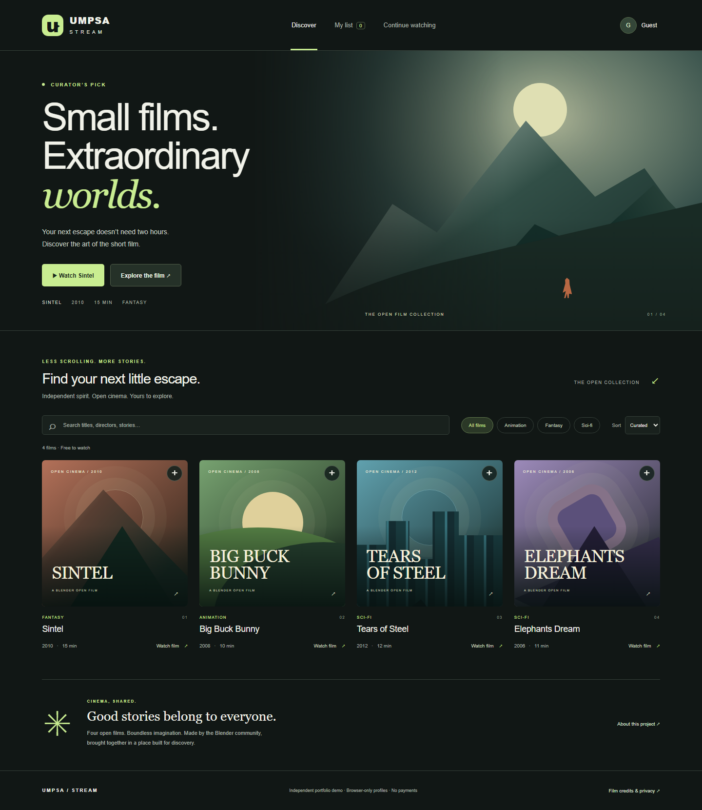

# UMPSA Stream

A working streaming-discovery portfolio demo, evolved from the **UMPSA Streaming Service System** university group coursework prototype.

**[Open the live demo](https://faridkamal2004.github.io/umpsa-streaming-service/)** · [Architecture](docs/ARCHITECTURE.md) · [Interview walkthrough](docs/INTERVIEW.md) · [Test report](docs/TESTING.md)



## What changed

The supplied project contained HTML form/report mockups, diagrams, and a system-analysis report. The login form had no application logic, and the browse form contained unrelated tuition-class content. This enhancement turns the streaming-service concept into an interactive, responsive frontend with reusable application logic and automated tests.

| Area | Enhanced behavior |
| --- | --- |
| Discovery | Search titles, directors, genres, and descriptions; combine genre and search filters |
| Sorting | Curated order, release year, duration, and alphabetical order |
| Personalization | Curated order prioritizes genres from saved or watched films; deterministic and explainable |
| My list | Save/remove films and retain the list across reloads |
| Playback | Native HTML video controls, progress persistence, resume, and network error messaging |
| Continue watching | Unfinished films appear automatically; films at least 95% complete are excluded |
| Profile | Browser-local display name, safe text rendering, and confirmed data reset |
| Resilience | Recover from corrupted storage and warn when persistence is unavailable |
| Presentation | Original abstract artwork, responsive layouts, keyboard focus states, semantic controls, native modal dialogs |
| Delivery | Unit tests, desktop/mobile browser tests, and test-gated GitHub Pages deployment |

## Run locally

Requires **Node.js 22 or newer**. There are no runtime npm dependencies.

```sh
npm ci
npm start
```

Open `http://127.0.0.1:4173`. Serve the project over HTTP; opening `index.html` as a `file://` URL will not reliably load ES modules.

```sh
npm test
npm run build
npx playwright install chromium
npm run test:e2e
```

On Linux, use `npx playwright install --with-deps chromium` if browser system libraries are missing. Build output is `dist/`. To preview the built artifact, run `node scripts/serve.mjs --dist`.

## Demo in two minutes

1. Search for `steel`, then combine the search with the Sci-fi filter.
2. Clear filters and change the sort order.
3. Save Sintel, open **My list**, and reload to show persistence.
4. Open a film, play it briefly, close the player, and open **Continue watching**.
5. Open the profile dialog, set a display name, and discuss local persistence versus real authentication.
6. Open the test suite and explain the invalid-state and failure-path coverage.

## Deploy on GitHub Pages

The workflow in `.github/workflows/pages.yml` runs the unit suite, builds the static site, runs Chromium tests for desktop and mobile, and deploys only after all checks pass.

In repository **Settings → Pages**, choose **GitHub Actions** as the build source. Push to `main` or run **Test and deploy demo** from Actions. Pull requests run tests without deploying. All asset paths are relative so the app works below a repository subpath.

## Scope and limitations

This is an independent **frontend portfolio demo**, not a commercial streaming platform or an official UMPSA service. There is no server, real sign-up/login, payment processing, entitlement enforcement, DRM, adaptive streaming, account synchronization, or offline media download. A profile is one local display name, not a secure account or multiple isolated users. No passwords or payment details are requested.

The four films stream from Internet Archive media mirrors and require internet access. Availability and media delivery are controlled by that external host. Progress saves every five seconds, on pause, when the page is hidden, and when the player closes; a sudden crash can lose recent seconds. The sample catalog contains no subtitle tracks. The interface provides keyboard controls and responsive styling, but this is not a claim of full WCAG conformance.

## Credits and provenance

The concept originated in a university **group** systems-analysis project; this repository presents a subsequent portfolio implementation and does not claim the original group work as a sole-authored production system. Original PDFs, peer evaluations, student identifiers, and the supplied background image are not published in this repository. See [provenance](docs/PROVENANCE.md).

Films are unmodified Blender open movies. See [THIRD_PARTY.md](THIRD_PARTY.md) for creators, sources, and licenses. All visual film artwork in this demo is original abstract CSS illustration, not official posters. No commercial movie posters or copyrighted streaming-service branding are included.

No license is granted for the original coursework by this repository. Third-party films retain their respective licenses. The repository intentionally does not add a blanket license to work whose original group ownership has not been confirmed.
